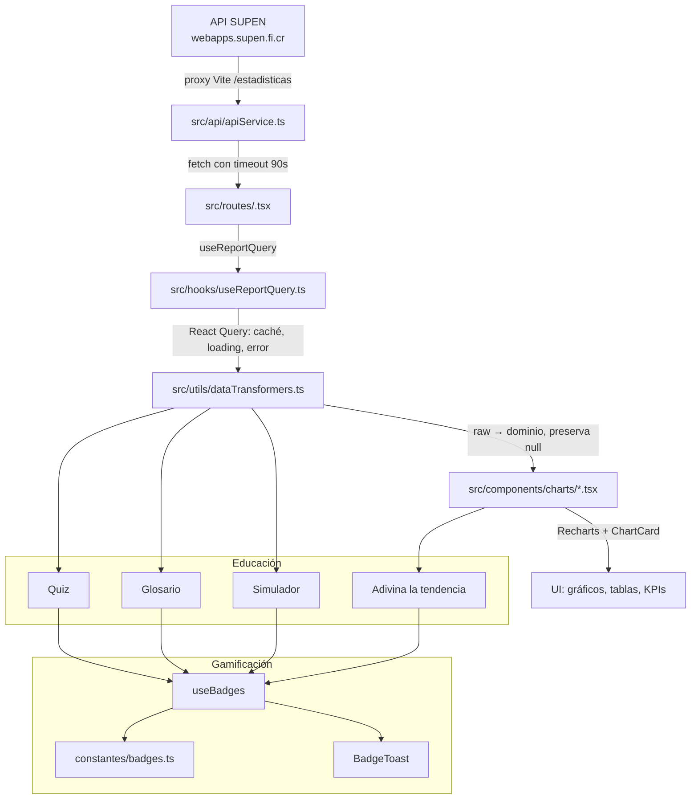

# SUPEN Stats

**Dashboard educativo e interactivo de estadísticas del sistema de pensiones de Costa Rica.**

Consume la API pública de la Superintendencia de Pensiones (SUPEN) para visualizar rentabilidad, comisiones, afiliados, activos, beneficios, traslados y más. Incluye herramientas de aprendizaje financiero: glosario, quiz interactivo, simulador de pensión y comparador de operadoras.

> ⚠️ **Aviso importante**: Este es un proyecto recreativo y educativo. **No es oficial** de la Superintendencia de Pensiones de Costa Rica (SUPEN) ni tiene afiliación con entes gubernamentales. Los datos provienen de la API pública de SUPEN y se presentan con fines de práctica de desarrollo web y educación financiera.


---

## 📸 Capturas de pantalla

A continuación se muestran las pantallas principales de la aplicación. Las imágenes se generan ejecutando `npm run dev` y navegando a cada ruta.

| Pantalla | Descripción |
|----------|-------------|
|  | Página de inicio con tarjetas agrupadas por categoría, botón "Sorpréndeme" y dato del día. |
|  | Reporte de series temporales con gráfico Recharts, alternador gráfico/tabla y exportación CSV. |
|  | Simulador de pensión con sliders interactivos, proyección de saldo y ajuste por inflación. |
|  | Comparador de dos operadoras con KPIs, gráfico comparativo y tabla exportable. |
|  | Glosario de términos con buscador y modo estudio (flashcards volteables). |
|  | Quiz educativo interactivo con confetti al obtener 100% y explicaciones por pregunta. |

> 💡 **Para generar las capturas**: ejecuta `npm run dev`, abre `http://localhost:3000` en cada ruta y toma una captura con herramientas nativas del sistema (ej. `Shift + Print` en Linux, `Cmd + Shift + 4` en macOS).


---

## 🚀 Funcionalidades principales

### Reportes estadísticos (17 reportes)

| Categoría | Reportes | Qué muestran |
|-----------|----------|--------------|
| **Rendimiento y costos** | Rendimiento, Rend. Real, Comisiones, Comisión vs Rend. | Rentabilidad nominal y real por operadora, comisiones cobradas, balance costo-rendimiento. |
| **Inversiones y cuentas** | Portafolio, Instrumentos (ISIN), Activos netos, Cuentas | Distribución de inversiones, títulos ISIN, patrimonio de fondos, desglose contable. |
| **Personas y demografía** | Afiliados, Aportantes, Beneficios, Demografía, Pirámide | Afiliados, aportantes activos, pensionados, distribución por sexo y edad. |
| **Movilidad y proyección** | Transferencias, Traslados, Simulador | Flujos entre operadoras, proyección de ahorro para la jubilación. |

### Interactividad avanzada

- **Brush/zoom** en gráficos de series temporales para explorar rangos de fechas.
- **Alternador gráfico ⇄ tabla** para ver los mismos datos en diferentes formatos.
- **Exportación a CSV** de cualquier reporte o comparación.
- **Estado en la URL**: filtros y vistas son compartibles vía enlace (back/forward funciona).
- **Sliders interactivos** en el simulador para ajustar saldo, aporte y edades en tiempo real.

### Educación financiera

- **Glosario** con buscador (sin distinción de acentos) y **modo estudio** con tarjetas volteables tipo flashcard.
- **Quiz interactivo** con preguntas sobre pensiones, confetti al 100% y explicaciones por respuesta.
- **Mini-juego "Adivina la tendencia"**: predice si la rentabilidad de una operadora subió o bajó entre dos cortes.
- **Rutas de aprendizaje guiadas** en la sección `/aprender`.
- **Metodología** transparente sobre el origen y limitaciones de los datos.

### Gamificación (insignias)

Sistema de 14 insignias desbloqueables almacenadas en `localStorage`:

| Categoría | Insignias | Cómo desbloquear |
|-----------|-----------|------------------|
| 🔍 Exploración | Primer reporte, Explorador, Coleccionista, Viajero del tiempo | Visitar reportes y categorías |
| 🎓 Aprendizaje | Glosario iniciado, Quiz perfecto, Aprendiz constante, Estudiando con flashcards, Adivinador | Glosario, quiz, flashcards, mini-juego |
| ⚡ Interacción | Exportador, Comparador, Líder de slider, Triple comparador | CSV, comparador, sliders, 3+ OPCs |
| 🌙 Personalización | Nocturno | Activar tema oscuro |


---

## 🛠️ Tecnologías

| Categoría | Tecnología | Versión |
|-----------|------------|---------|
| Framework | React | 19 |
| Lenguaje | TypeScript | 5 |
| Build tool | Vite | 8 |
| Estilos | Tailwind CSS | 4 |
| Gráficos | Recharts | 3 |
| Ruteo | TanStack Router | 1.170 |
| Estado remoto | TanStack Query | 5 |
| Validación | Zod | 4 |
| Tests | Vitest | 4 |
| Linter | oxlint | 1 |
| PWA | Service Worker + Workbox | — |

---

## 📦 Instalación y puesta en marcha

### Requisitos previos

- Node.js 18+
- npm 9+

### Comandos

```bash
# 1. Clonar el repositorio
git clone https://github.com/Chienwei82/SupenStats.git
cd SupenStats

# 2. Instalar dependencias
npm install

# 3. Servidor de desarrollo (http://localhost:3000)
npm run dev

# 4. Build para producción
npm run build

# 5. Vista previa del build
npm run preview
```

### Verificación de calidad

```bash
# Lint + typecheck + tests (ejecutar antes de cada commit/PR)
npm run verify

# Solo tests
npm test

# Solo lint
npm run lint

# Solo typecheck
npm run typecheck
```


---

## 🏗️ Arquitectura del sistema



### Capas de datos

1. **API SUPEN** — fuente de datos públicos (webapps.supen.fi.cr).
2. **apiService.ts** — fetcher con `assertArray`, timeout de 90s, validación de respuesta.
3. **dataTransformers.ts** — transforma campos crudos (minúscula, con acentos) a tipos de dominio (PascalCase). **Nunca convierte `null` en `0`.**
4. **useReportQuery** — React Query con caché, loading, error, refetch y lazy loading por pestaña.
5. **Componentes UI** — Recharts para gráficos, `ChartCard` como contenedor accesible, `ReportView` para estados de carga/error.

---

## 📁 Estructura de carpetas

```
SupenStats/
├── README.md                 # Esta documentación
├── CONTRIBUTING.md           # Guía de contribución detallada
├── SPEC.md                   # Especificación técnica del proyecto
├── vercel.json               # Configuración de despliegue en Vercel
├── vite.config.ts            # Configuración de Vite
├── tsconfig.json             # Configuración de TypeScript
├── public/
│   ├── og-image.png          # Imagen para redes sociales
│   ├── manifest.webmanifest  # PWA manifest
│   ├── sw.js                 # Service worker (offline)
│   └── icons.svg             # Iconos del sistema
├── src/
│   ├── api/                  # Capa de datos (fetcher, tipos raw)
│   ├── components/
│   │   ├── charts/           # Componentes de gráficos Recharts
│   │   ├── education/        # Quiz, glosario, simulador, mini-juegos
│   │   ├── layout/           # Header, WelcomeScreen, ReportTabs, ThemeToggle
│   │   ├── Compare/          # Comparador de operadoras
│   │   └── ui/               # Componentes base (ChartCard, ReportView, etc.)
│   ├── hooks/                # Custom hooks (useReportQuery, useBadges, etc.)
│   ├── constants/            # Constantes (badges, quiz, glosario, filtros)
│   ├── routes/               # Rutas de TanStack Router
│   ├── types/                # Tipos de dominio y Raw* de la API
│   └── utils/                # Utilidades (transformers, export, search)
├── docs/                     # Documentación técnica
│   ├── screenshots/          # Capturas de pantalla (placeholders)
│   ├── architecture.md       # Arquitectura detallada
│   ├── components.md         # Referencia de componentes UI
│   ├── hooks.md              # Referencia de hooks
│   ├── education.md          # Sistema educativo
│   └── gamification.md       # Sistema de insignias
├── memory-bank/              # Contexto persistente para asistentes de código
├── scripts/                  # Scripts de Git (rama, limpieza)
└── dist/                     # Build de producción (generado)
```


---

## 🛤️ Roadmap

### Fase 1 ✅ — Reportes base
- 17 reportes con datos reales de SUPEN
- Navegación agrupada con buscador
- Brush/zoom en gráficos
- Alternador gráfico/tabla y exportación CSV

### Fase 2 ✅ — Educación
- Glosario con buscador
- Quiz interactivo con confetti
- Metodología y transparencia de datos

### Fase 3 ✅ — Interactividad
- Simulador de pensión con sliders
- Comparador de operadoras
- Dato del día y botón "Sorpréndeme"

### Fase 4 ✅ — Gamificación
- 14 insignias desbloqueables
- Modo estudio (flashcards)
- Mini-juego "Adivina la tendencia"

### 🔮 Fase 5 — Planificada
- Comparador de 3+ operadoras (extendido)
- Racha de visitas diarias (streak)
- "Mi resumen del año" (tipo Spotify Wrapped)
- Flashcards del glosario como sección independiente

---

## ❓ Preguntas frecuentes

### ¿Es este un producto oficial de SUPEN?

No. Es un proyecto de código abierto creado con fines educativos y de práctica de desarrollo web. Los datos provienen de la API pública de SUPEN pero la aplicación no está afiliada a la institución.

### ¿Puedo usar los datos para decisiones financieras?

Los datos se presentan con fines informativos y educativos. Para decisiones financieras reales, consulte directamente con SUPEN y un asesor financiero certificado.

### ¿Cómo agrego un nuevo reporte?

1. Definir tipos de dominio y `Raw*` en `src/types/supen.ts`
2. Agregar función fetch en `src/api/apiService.ts`
3. Agregar transformación en `src/utils/dataTransformers.ts`
4. Crear ruta en `src/routes/<nombre>.tsx` con `createReportRoute<T>`
5. Agregar componente de gráfico en `src/components/charts/`
6. Registrar en `src/components/layout/ReportTabs.tsx`

Ver guía completa en [`CONTRIBUTING.md`](CONTRIBUTING.md).

### ¿Cómo funcionan las insignias?

Las insignias se almacenan en `localStorage` del navegador. Cada insignia tiene una condición pura que se evalúa contra la actividad del usuario (visitas, quiz, sliders, etc.). Al desbloquearse, aparece una notificación accesible (`BadgeToast`). Ver [`docs/gamification.md`](docs/gamification.md).

### ¿La aplicación funciona sin conexión?

Sí, es una PWA (Progressive Web App) con service worker que cachea el app shell. Puede instalarse como aplicación en dispositivos móviles y de escritorio.

---

## 🤝 Contribuir

¡Las contribuciones son bienvenidas! Antes de abrir un PR:

1. Lee [`CONTRIBUTING.md`](CONTRIBUTING.md) para convenciones de ramas y commits.
2. Ejecuta `npm run verify` para asegurar calidad de código.
3. Para reportes nuevos, incluye `SPEC.md` y `DESIGN.md` en `docs/reportes/<nombre>/`.

Tipos de rama válidos: `feat`, `fix`, `chore`, `refactor`, `hotfix`, `docs`.

---

## 📄 Licencia

Este proyecto es de código abierto y está disponible para fines educativos. Los datos de SUPEN son públicos y provienen de [webapps.supen.fi.cr](https://webapps.supen.fi.cr/Estadisticas/ui).

---

## 🙌 Créditos

| Recurso | Enlace |
|---------|--------|
| Datos | [Superintendencia de Pensiones (SUPEN)](https://www.supen.fi.cr) |
| Gráficos | [Recharts](https://recharts.org) |
| Estilos | [Tailwind CSS](https://tailwindcss.com) |
| Framework | [React](https://react.dev) |
| Build | [Vite](https://vitejs.dev) |
| Ruteo | [TanStack Router](https://tanstack.com/router) |
| Estado remoto | [TanStack Query](https://tanstack.com/query) |

---

<p align="center">
  <b>SUPEN Stats</b> — Educación financiera hecha accesible para todos los costarricenses 🇨🇷
</p>
